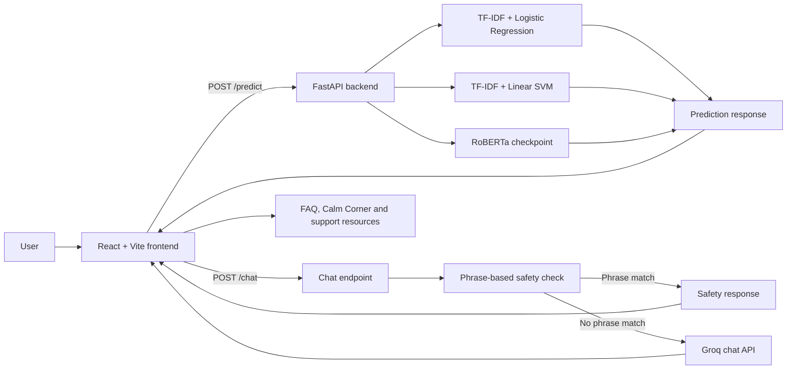

# SocialSense
### Stress-related text analysis and AI-supported wellbeing experience

SocialSense is an educational NLP application that explores how stress-related language can appear in short-form text. It brings together three text-classification approaches and a set of interactive wellbeing features in a web application.

The project is designed as a research and software demonstration. Its predictions describe patterns in the submitted text; they do **not** assess a person's mental-health status or provide a clinical diagnosis.

---

## Overview

SocialSense combines:

- **Text classification:** compares predictions from Logistic Regression, Linear Support Vector Machine (SVM), and a fine-tuned RoBERTa sequence-classification model.
- **AI Companion:** provides supportive, non-clinical conversation through a Groq-hosted chat model using an OpenAI-compatible API client.
- **Help & Hope:** searchable answers to common questions about stress and wellbeing.
- **Calm Corner:** guided breathing, a 5–4–3–2–1 grounding activity, and a journal note held only in the current browser session.
- **Reach Out:** displays support contacts and emergency resources for users in India.

## Key features

### 1. Multi-model stress-related text analysis

A user can enter a short text passage or select a sample prompt. The frontend sends the text to the FastAPI backend, which returns predictions from the available models:

| Model | Role in the application |
|---|---|
| Logistic Regression | TF-IDF-based baseline classifier |
| Linear SVM | TF-IDF-based baseline classifier |
| RoBERTa | Transformer-based sequence classifier |

When the RoBERTa checkpoint is available, the API also returns the predicted class confidence and the probabilities for the two output classes. The inference code tokenizes input with truncation and a maximum sequence length of 256 tokens.

The application displays the model outputs side by side so users can inspect how different approaches classify the same text. A model prediction is not a measure of a person's actual stress level.

### 2. SocialSense AI Companion

The AI Companion accepts a message and recent conversation history through the `/chat` endpoint. The backend:

1. Checks the message against a small set of predefined crisis-related phrases.
2. Returns a fixed safety-oriented response when one of those phrases is detected.
3. Otherwise sends the conversation to a Groq-hosted chat model using the OpenAI Python SDK with a Groq-compatible API base URL.
4. Applies a system prompt that asks the assistant to be supportive and non-judgmental, avoid diagnosis or medication advice, and encourage human or professional support when appropriate.

The current phrase screening is intentionally simple. It is **not** a validated crisis-detection system and can miss expressions that do not match the listed phrases or flag phrases without understanding their context. The companion is not a therapist, emergency service, or substitute for professional care.

### 3. Help & Hope

A searchable FAQ presents concise information about stress, academic pressure, feeling overwhelmed, sleep routines, and when to consider professional support. Search filters the questions and answers in the frontend.

### 4. Calm Corner

The interactive wellbeing area includes:

- **Gentle breathing:** a simple on-screen breathing prompt. Users are advised not to force or hold their breath.
- **5–4–3–2–1 grounding:** a step-by-step sensory grounding activity.
- **Mindful journal:** a text note that remains in the page's current session. The current implementation does not send the journal note to the backend or permanently store it.

### 5. Reach Out

The application displays support information for India, including Tele-MANAS (14416) and emergency assistance (112), along with a reminder to contact a trusted person or qualified professional when needed. Check official sources for current availability and guidance.

---

## System architecture



### Request flow

**Text analysis**

1. The user submits text in the React interface.
2. The frontend sends a JSON request to `POST /predict`.
3. FastAPI validates the request and calls the `StressPredictor`.
4. The predictor runs the Logistic Regression and Linear SVM pipelines and, when the local checkpoint is available, runs RoBERTa inference with PyTorch.
5. The backend returns the predictions and RoBERTa probabilities to the frontend.

**AI Companion**

1. The user sends a message from the chat interface.
2. The frontend includes recent conversation messages in the request.
3. The backend applies phrase-based crisis screening.
4. If no listed phrase is found, the backend sends the conversation to the configured Groq model.
5. The reply is returned to the frontend and displayed in the chat.

---

## Technology stack

| Area | Technologies |
|---|---|
| Frontend | React, JavaScript, Vite, CSS |
| UI and animation | Framer Motion, Lucide React |
| Backend | Python, FastAPI, Uvicorn |
| Classical machine learning | scikit-learn, joblib |
| Transformer inference | PyTorch, Hugging Face Transformers |
| Chat integration | Groq API through the OpenAI-compatible Python SDK |
| Configuration | python-dotenv |

---

## Repository structure

```text
mental_health_prediction/
├── app/
│   └── predictor.py             # Loads models and performs inference
├── backend/
│   └── main.py                  # FastAPI routes and chat integration
├── data/
│   └── raw/
│       └── dreaddit/            # Dataset location
├── frontend/
│   ├── src/
│   │   ├── App.jsx              # Main application and prediction UI
│   │   └── Features.jsx         # Companion and wellbeing features
│   └── package.json
├── models/
│   ├── baseline_stress/         # Classical model artifacts
│   └── roberta_stress_v2/       # Local RoBERTa checkpoint expected by inference
├── notebooks/                   # Exploratory and model-development notebooks
├── results/                     # Project outputs and evaluation artifacts
├── scripts/                     # Supporting scripts
├── requirements.txt
└── README.md
```

The RoBERTa inference code expects a local checkpoint at `models/roberta_stress_v2/`. The baseline inference code expects the two joblib artifacts in `models/baseline_stress/`. Model weights may not be included in every clone; see the setup notes below.

---

## Getting started

### Prerequisites

Install the following before running the application:

- Python 3.10 or a compatible Python version for the installed dependencies
- Node.js and npm
- Git

### 1. Clone the repository

```bash
git clone https://github.com/sudh1404/mental_health_prediction.git
cd mental_health_prediction
```

### 2. Set up the Python environment

**Windows PowerShell**

```powershell
python -m venv .venv
.\.venv\Scripts\Activate.ps1
pip install -r requirements.txt
```

**macOS / Linux**

```bash
python3 -m venv .venv
source .venv/bin/activate
pip install -r requirements.txt
```

### 3. Add the chat API configuration

Create a `.env` file in the repository root:

```dotenv
GROQ_API_KEY=your_groq_api_key
GROQ_CHAT_MODEL=openai/gpt-oss-20b
```

Replace the placeholder with your own Groq API key. Keep the `.env` file private; never commit API keys, tokens, or other secrets.

The chat endpoint requires `GROQ_API_KEY`. Text prediction does not require the chat API key.

### 4. Check model artifacts

Before starting the backend, confirm that the expected model files are present:

- `models/baseline_stress/tfidf_logistic_stress.joblib`
- `models/baseline_stress/tfidf_linear_svm_stress.joblib`
- The RoBERTa checkpoint directory: `models/roberta_stress_v2/`

The backend loads the baseline artifacts during predictor initialization. If the RoBERTa checkpoint cannot be loaded, the predictor is designed to continue with the two baseline models.

If model artifacts are not present in the repository, obtain them from the project's authorized source or follow the project's model-training notebooks/scripts. Do not download model files from untrusted sources.

### 5. Start the backend

From the repository root, with the Python virtual environment activated:

```bash
python -m uvicorn backend.main:app --reload --host 127.0.0.1 --port 8000
```

The API is available at `http://127.0.0.1:8000`. FastAPI's interactive API documentation is available at `http://127.0.0.1:8000/docs`.

### 6. Start the frontend

Open a second terminal:

```bash
cd frontend
npm install
npm run dev
```

Open the local URL printed by Vite, usually `http://localhost:5173`.

---

## API reference

| Method | Endpoint | Purpose |
|---|---|---|
| GET | `/` | Returns API status and available feature names |
| GET | `/health` | Reports predictor readiness and whether chat is configured |
| POST | `/predict` | Returns predictions from the available text-classification models |
| POST | `/chat` | Returns a supportive companion response or a phrase-triggered safety response |

### Example: prediction request

```json
{
  "text": "I have several deadlines and I am finding it difficult to concentrate."
}
```

The response includes the submitted text, the Logistic Regression prediction, the Linear SVM prediction, and the RoBERTa prediction fields. RoBERTa probability fields are `null` when the checkpoint is unavailable.

### Example: chat request

```json
{
  "message": "I have been feeling overwhelmed by my workload.",
  "history": []
}
```

The chat endpoint accepts a message and an optional conversation history. The backend limits the history used for the model request to the most recent ten messages.

---

## Dataset and model development

The project uses the **Dreaddit** dataset for stress-related text classification. The repository contains a dataset directory at `data/raw/dreaddit/` and model-development notebooks under `notebooks/`.

The deployed inference layer exposes three classifiers:

- TF-IDF with Logistic Regression
- TF-IDF with Linear SVM
- RoBERTa sequence classification

This README intentionally does not publish accuracy, precision, recall, or F1 values. Such figures should be added only alongside the exact evaluation split, preprocessing, label mapping, and reproducible evaluation outputs used to obtain them.

Before redistributing the dataset or trained model artifacts, review their original source terms and licensing conditions.

---

## Responsible use, privacy and limitations

- SocialSense is an educational project and research demonstration, not a medical product.
- Text classifications are experimental model outputs and must not be interpreted as diagnoses or clinical assessments.
- The AI Companion can generate inaccurate or incomplete responses. It should not be relied on for crisis support or urgent decisions.
- Crisis phrase screening is a basic keyword check, not a clinically validated risk assessment.
- Avoid entering personally identifying, confidential, or highly sensitive information.
- The mindful journal is held in frontend component state for the current page session; it is not sent to the backend or permanently stored by the current implementation.
- Chat messages are sent to the configured external Groq API when the chat endpoint is used. Review the provider's terms and privacy policy before entering any personal information.
- Keep API credentials in environment variables and out of version control.

For immediate danger in India, contact emergency services at **112**. Tele-MANAS can be reached at **14416**. Verify current details through official sources.

---

## Potential future work

- Add a reproducible evaluation pipeline with documented train, validation, and test splits.
- Report per-class precision, recall, F1-score, confusion matrices, and calibration where appropriate.
- Test generalisation across datasets and text sources.
- Improve crisis-support handling with carefully evaluated safety workflows and clear escalation guidance.
- Add automated backend and frontend tests.
- Improve deployment configuration, logging, accessibility, and user-facing privacy information.

---

## Project maintenance

**Maintained by:** Sudharshana Suryanarayanan  
**Repository:** [sudh1404/mental_health_prediction](https://github.com/sudh1404/mental_health_prediction)

SocialSense is an academic project developed as a collaborative effort. This repository is maintained as part of the maintainer's technical portfolio.

